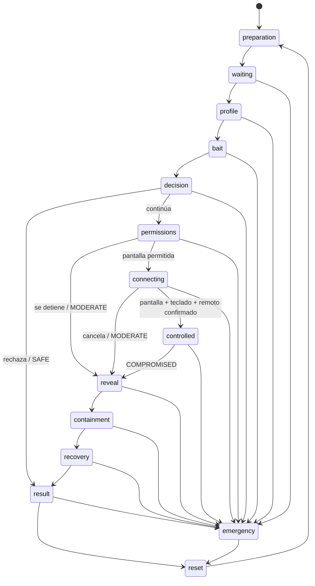

# Fase 2 — Dominio y máquina de estados

## 1. Fuente de verdad

Los contratos compartidos viven en `src/shared`:

- `types.ts`: sesión, participantes, permisos, riesgo, cronología, control remoto y temporizador.
- `session.ts`: fábrica de sesiones y actualizaciones inmutables.
- `state-machine.ts`: transiciones, invariantes, finales, parada de emergencia y reinicio.
- `schemas.ts`: validación Zod para datos que crucen la red.

Ningún panel debe inventar su propio estado. En fases posteriores el servidor conservará la sesión canónica y los clientes recibirán vistas autorizadas.

## 2. Diagrama actualizado

## 3. Invariantes

1. Solo se aceptan aristas declaradas; cualquier salto produce `TransitionError`.
2. `connecting` exige permiso de pantalla concedido.
3. `controlled` exige pantalla, teclado y control remoto confirmado manualmente.
4. El camino seguro termina directamente desde `decision` con resultado `safe`.
5. Una revelación anticipada desde permisos o conexión exige resultado `moderate`.
6. Entrar a `controlled` fija resultado `compromised`.
7. La parada de emergencia está disponible durante toda fase activa, pausa el temporizador y comienza el cierre remoto.
8. El reinicio acepta cualquier fase y devuelve permisos, participantes, riesgo y control remoto a valores limpios.

## 4. Tres finales

| Final           | Decisión                   | Recorrido                                       | Mensaje educativo                                          |
| --------------- | -------------------------- | ----------------------------------------------- | ---------------------------------------------------------- |
| Seguro          | Rechaza la solicitud       | `decision → result`                             | Verificar antes de conceder acceso evita el incidente      |
| Riesgo moderado | Acepta algo y se detiene   | `permissions/connecting → reveal → … → result`  | Detectar señales temprano limita el daño                   |
| Compromiso alto | Concede pantalla y control | `connecting → controlled → reveal → … → result` | Un permiso aparentemente pequeño permite observar y actuar |

## 5. Consola de depuración

La ruta `/debug` permite validar el dominio sin esperar los paneles finales:

- muestra las 14 fases;
- ofrece únicamente transiciones válidas;
- permite conceder pantalla/teclado y confirmar control remoto;
- muestra resultado, revisión, riesgo, permisos y cronología;
- permite parada de emergencia y reinicio;
- anuncia errores de invariantes mediante una región `aria-live`.

Esta consola es para desarrollo y ensayo. No enseña a ejecutar ataques y no controla el sistema operativo.

## 6. Cobertura exigida

Las pruebas unitarias verifican:

- todos los roles, permisos y resultados;
- creación y actualización inmutable de sesión;
- todas las aristas válidas del grafo;
- rechazo de transiciones inexistentes;
- bloqueo de `controlled` sin permisos o confirmación;
- los tres finales;
- parada de emergencia desde cada fase activa;
- reinicio desde todas las fases;
- aceptación y rechazo de contratos Zod.
